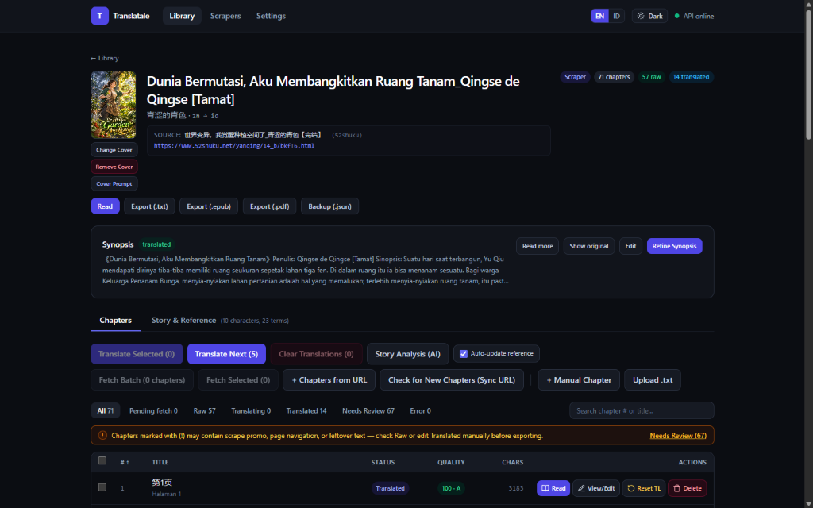
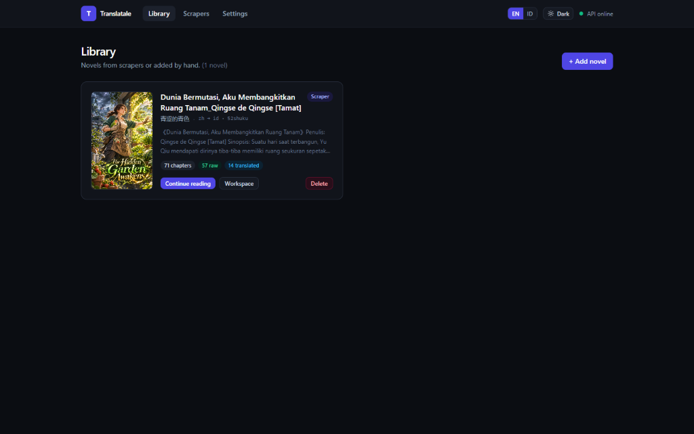
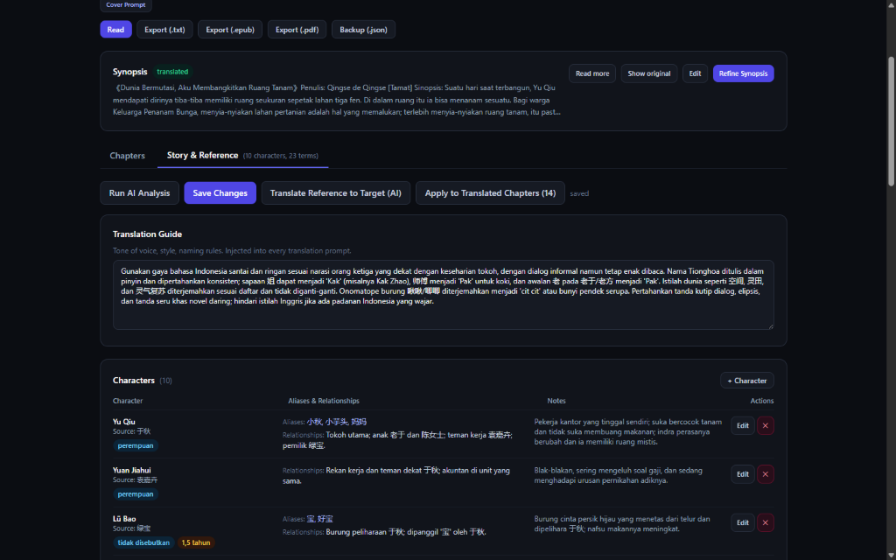
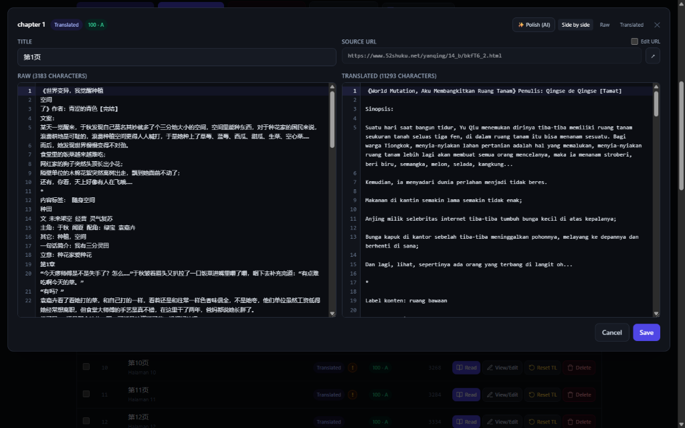
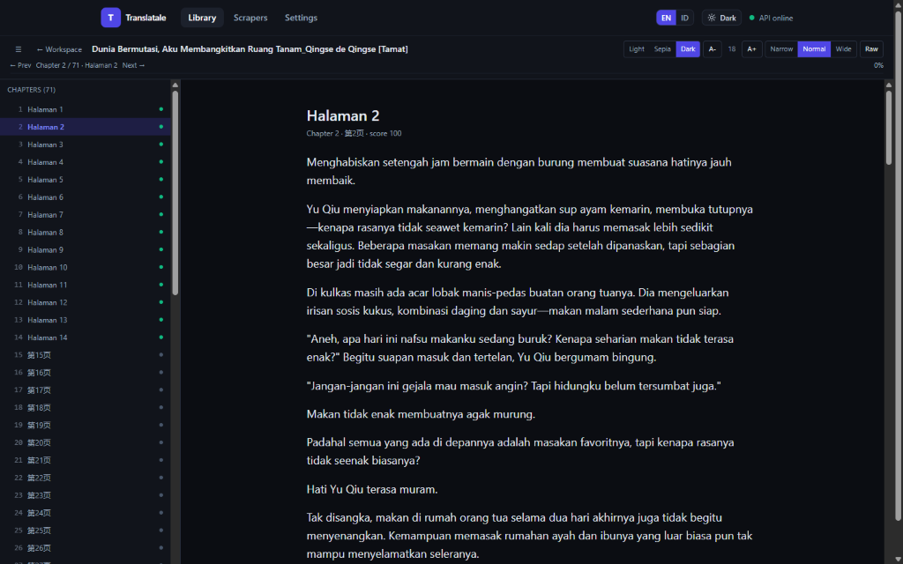
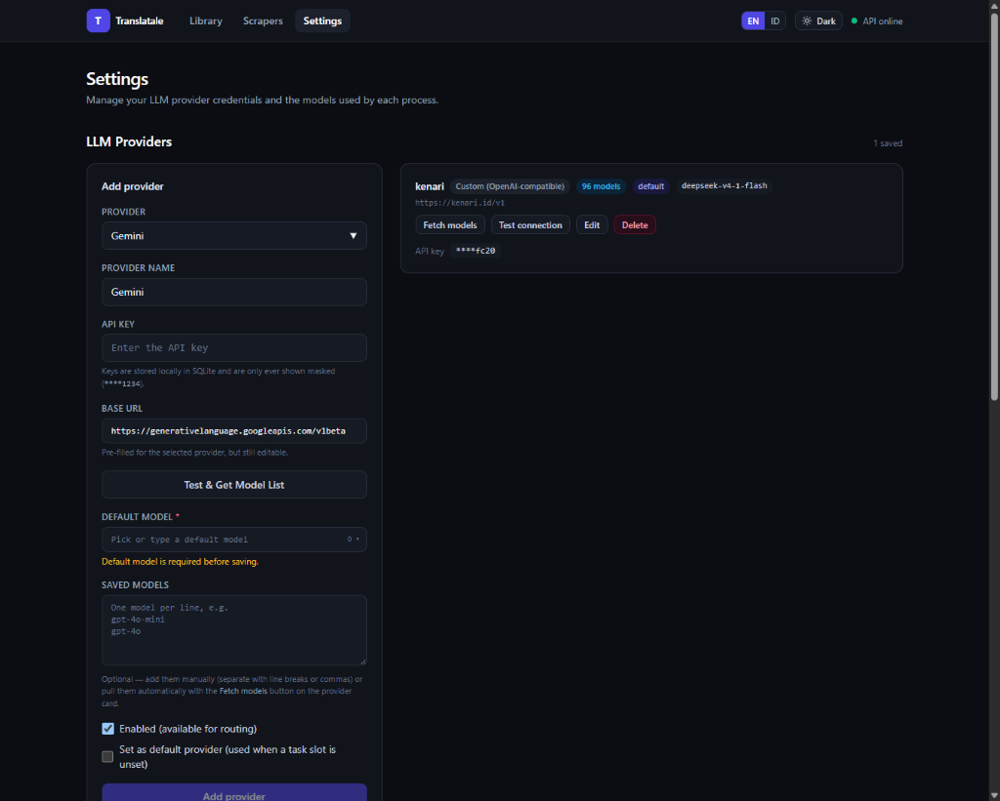

<div align="center">

# 📖 Translatale

**Penerjemah Web Novel & Light Novel AI berbasis Web dengan Story Bible dan Reader Terintegrasi**

Translatale (*Translate* + *Tale*) membantu Anda mengambil bab (*scraping*), menganalisa cerita, menerjemahkan, menyunting gaya bahasa, dan membaca web novel Mandarin, Jepang, maupun Korea dengan nama karakter, lokasi, serta glosarium yang konsisten — didukung oleh **Gemini, OpenAI, DeepSeek, OpenRouter, Anthropic, Ollama, CLI subscription lokal (`agy` / `codex`), dan API OpenAI-compatible lainnya**.

[](https://github.com/andrian531/translatale/stargazers)
[](https://github.com/andrian531/translatale/issues)
[](LICENSE)
[](https://github.com/andrian531/translatale/releases)

[](https://www.python.org)
[](https://fastapi.tiangolo.com)
[](https://vuejs.org)
[](https://tailwindcss.com)
[](https://sqlite.org)

[Mulai Cepat](#-mulai-cepat) · [Tangkapan Layar](#-tangkapan-layar) · [Fitur](#-fitur) · [Arsitektur](#-arsitektur) · [English](README.md)

</div>

> **Latar Belakang:** Translatale merupakan pengembangan dan penulisan ulang dari [andrian531/novel-translator](https://github.com/andrian531/novel-translator), membawa alur kerja terjemahan berbasis konteks, pemecahan chunk, dan referensi cerita ke atas arsitektur **FastAPI + SQLite + Vue 3** dengan scraper modular per situs, skill AI berbasis Markdown, serta UI dwibahasa (`EN` / `ID`) bertema Gelap & Terang.

---

## 📸 Tangkapan Layar

### Workspace & Daftar Bab
*Info novel, thumbnail cover 2:3, ekspor multi-format, sinopsis terjemahan, toolbar aksi 2 baris, penanda kebersihan bab, dan skor kualitas.*



<details>
<summary>🖼️ Lihat tangkapan layar lainnya (Library, Reference Sheet, Editor &amp; Polish, Web Reader, Settings)</summary>

#### Library


#### Analisa Cerita & Lembar Referensi


#### Modal View/Edit (Nomor Baris CodeMirror 6 + AI Polish)


#### Web Reader Terintegrasi


#### Pengaturan Multi-Provider LLM & Routing


</details>

---

## ✨ Fitur

### 🧠 Analisa Cerita & Lembar Referensi Hidup

| Fitur | Deskripsi |
| --- | --- |
| **Ekstraksi Cerita & Entitas AI** | Mengekstrak **Karakter** (nama asli, romanisasi, usia, gender, alias, relasi, catatan), **Lokasi**, **Istilah / Glosarium**, serta **Translation Guide** langsung dalam bahasa target novel |
| **Toggle Format Latin per Baris** | Aktifkan **Latin** pada istilah atau lokasi tertentu agar ditulis dalam format `Romanisasi (Terjemahan)` (misal: `kōngjiān (ruang)`) di seluruh terjemahan |
| **Rapikan Bahasa Referensi (AI)** | Mengonversi entri lama Reference Sheet yang masih berbahasa Inggris ke bahasa target (`Indonesian`) dalam 1 klik tanpa menghapus entri yang ada |
| **Apply Reference Paralel 5×** | Menyelaraskan bab yang sudah diterjemahkan hingga 5 bab sekaligus sambil membandingkan `[SOURCE TEXT]` asli dengan `[EXISTING TRANSLATION]` agar istilah bertumpuk tidak tertukar |
| **Ringkasan Konteks Bergulir** | Meringkas bab ke `STORY SO FAR` (maksimal 5 bab terakhir) untuk menjaga kesinambungan alur tanpa membengkakkan ukuran prompt |

### ✍️ Terjemahan Sadar-Konteks & Skill Editor

| Fitur | Deskripsi |
| --- | --- |
| **Chunking & Retry Otomatis** | Memecah bab panjang di batas paragraf/kalimat, menyuntikkan Reference Sheet + `STORY SO FAR` + ekor chunk sebelumnya, retry otomatis, dan berhenti bila ada bab gagal |
| **Skill AI Markdown (`backend/skills/`)** | Instruksi prompt dalam file Markdown terpisah untuk terjemahan, penyuntingan EYD V & anti-*translationese* (`editor_id.md`, `editor_en.md`), polish, sinopsis, dan analisa cerita |
| **Translate Next (5) & Penjaga Urutan** | Menerjemahkan 5 bab berikutnya dalam 1 klik, serta peringatan sebelum menerjemahkan bab yang melompati bab belum diterjemahkan |
| **Logger & Loader Dwibahasa Real-Time** | Progress bar dan log SSE otomatis mengikuti bahasa UI aktif (`EN` / `ID`), termasuk saat bahasa diganti di tengah proses |
| **Cek Kebersihan Bab & Hapus Baris Kotor** | Menandai bab yang masih memuat promosi situs, navigasi (`目录`, `Halaman sebelumnya`), sisa HTML, teks pendek, atau sisa CJK dengan ikon `!` yang bisa dihapus langsung di modal editor |
| **Editor CodeMirror 6 & Preview Diff Ala GitHub** | Editor `Raw` & `Translated` bernomor baris dengan sorotan baris kotor dan tombol **`✨ Polish (AI)`** yang menampilkan perbandingan 2 kolom (*Before vs After*) sebelum disimpan |

### 🌐 Scraper Modular & Input Bab

| Fitur | Deskripsi |
| --- | --- |
| **Scraper Modular per Situs** | Adapter situs di `backend/scrapers/sites/` lengkap dengan pratinjau URL, sinkronisasi daftar bab (*Cek Bab Baru*), tautan sumber, dan **Scraper AI Analyzer** |
| **Batch Fetch & Circuit Breaker** | Pengambilan isi bab di latar belakang dengan jeda rate-limit, ukuran batch fleksibel, dan penghentian otomatis jika terjadi error beruntun |
| **Input Manual & Upload `.txt`** | Tambah bab manual, masukkan daftar URL, atau unggah banyak file `.txt` sekaligus ke workspace novel |

### 📚 Web Reader, Cover & Ekspor E-Book

| Fitur | Deskripsi |
| --- | --- |
| **Web Reader Terintegrasi** | Tampilan baca nyaman dengan tema **Gelap / Sepia / Terang**, pengaturan ukuran font & lebar baca, sidebar daftar bab, dan pelacakan bab terakhir dibaca |
| **Ekspor Multi-Format** | Ekspor bab terjemahan ke **`.epub`** (e-book lengkap dengan cover & daftar isi), **`.pdf`** (halaman cover penuh & tiap bab mulai di halaman baru), **`.txt`**, dan backup **`.json`** |
| **Thumbnail Cover & Generator Prompt AI** | Upload cover 2:3 untuk Library, Workspace, EPUB, dan PDF, atau buat prompt ilustrasi cover AI dalam format **Text + Negative** dan **JSON** terstruktur |

### ⚙️ Routing LLM Multi-Provider & UI Dwibahasa

| Fitur | Deskripsi |
| --- | --- |
| **7+ Dukungan Provider + CLI Lokal** | Mendukung **Gemini, OpenAI, DeepSeek, OpenRouter, Anthropic, Ollama, Custom OpenAI-compatible**, serta CLI lokal **`agy` (Antigravity CLI)** dan **`codex` (OpenAI Codex CLI)** agar bisa memakai subscription tanpa API key tambahan |
| **Routing per Proses & Model Cadangan** | Atur model utama + cadangan secara terpisah untuk `translate`, `scrape_analysis`, `story_analysis`, dan `cover_prompt`, plus **Default Provider & Model** |
| **UI EN / ID & Tema Gelap / Terang** | Penggantian bahasa dan tema secara instan dengan dukungan aksesibilitas keyboard (`focus-visible`) dan tabel responsif |

---

<details>
<summary>🗺️ Peta Arsitektur &amp; Komponen</summary>

| Lapisan | Modul Utama | Fungsi |
| --- | --- | --- |
| **API & Job** | `backend/main.py`, `backend/routers/*.py`, `backend/core/job_runner.py` | Endpoint FastAPI, middleware `X-UI-Lang`, background job, dan stream log SSE |
| **AI & Skill** | `backend/core/skills.py`, `backend/skills/*.md`, `backend/core/translator.py`, `backend/core/analyzer.py` | Loader skill Markdown, penerjemah chunk, penyunting/polish, dan analisa cerita JSON |
| **Kualitas & Ekspor** | `backend/core/quality.py`, `backend/core/exporter.py`, `backend/core/synopsis.py` | Deteksi kebersihan bab, skor kualitas, dan pembuat EPUB/PDF/TXT/JSON |
| **Scraper & DB** | `backend/scrapers/`, `backend/database.py` | Registry scraper per situs dan database SQLite lokal (`backend/data/translatale.db`) |
| **Frontend Vue 3** | `frontend/src/views/{Library,Workspace,Reader,Scrapers,Settings}View.vue` | Antarmuka Vue 3 + Vite + Tailwind CSS + CodeMirror 6 (`LineNumberEditor`) + Split Diff |

</details>

---

## 🚀 Mulai Cepat

### Cara Cepat (Windows)

Klik dua kali `start.bat` (atau jalankan `.\start.bat` di terminal). Script ini otomatis:
1. Membuat `backend\.venv` dan menginstall `backend\requirements.txt`.
2. Menginstall `frontend\node_modules` melalui `npm`.
3. Menjalankan backend (`:8000`) dan frontend (`:5173`) dalam satu jendela dengan prefix `[BE]` / `[FE]` lalu membuka `http://localhost:5173`.

Tekan `Ctrl+C` atau jalankan `stop.bat` untuk menghentikan server.

### Setup Manual

**Backend** (Python 3.10+):

```bash
cd backend
python -m venv .venv
.venv\Scripts\activate          # Linux/macOS: source .venv/bin/activate
pip install -r requirements.txt
uvicorn main:app --reload --port 8000
```

Dokumentasi API: `http://127.0.0.1:8000/docs` · Health check: `http://127.0.0.1:8000/api/health`

**Frontend** (Node.js 18+):

```bash
cd frontend
npm install
npm run dev                     # http://localhost:5173 (proxy /api -> :8000)
```

### Pengujian & Build

```bash
# Test backend
cd backend
.venv\Scripts\python -m pytest -v

# Build produksi frontend
cd frontend
npm run build
```

Database SQLite dibuat otomatis di `backend/data/translatale.db` (dapat diubah lewat `TRANSLATALE_DB_PATH` atau `TRANSLATALE_DATA_DIR`).

---

## 📄 Lisensi

Dirilis di bawah **Lisensi MIT**. Lihat berkas [`LICENSE`](LICENSE) untuk detail lengkapnya.
