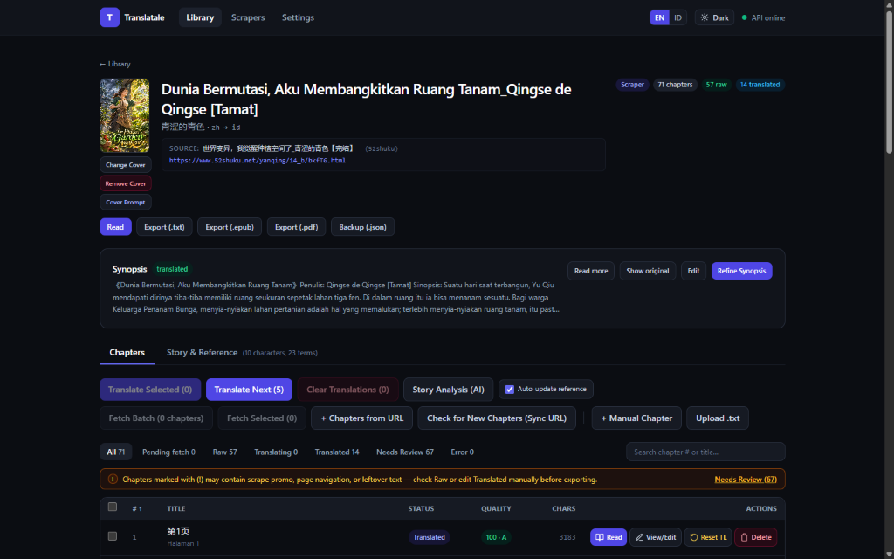
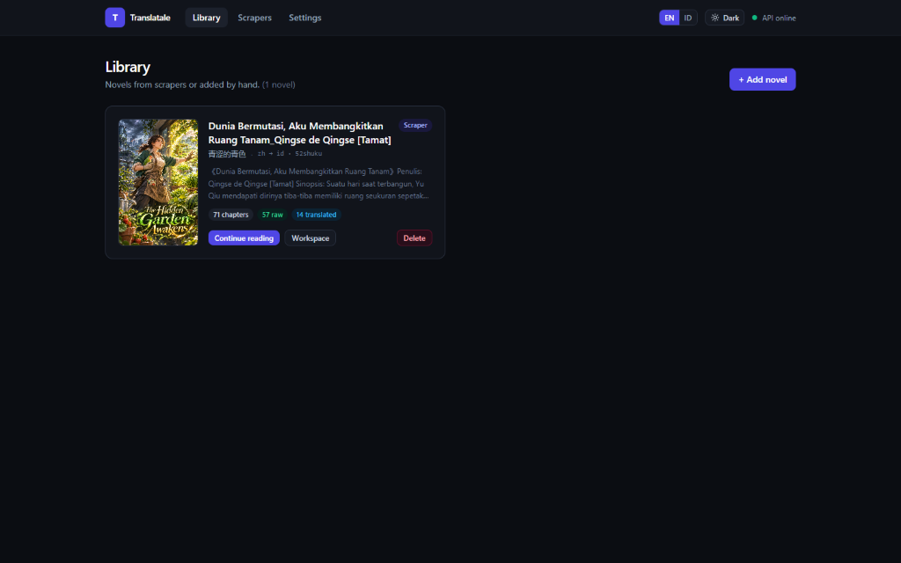
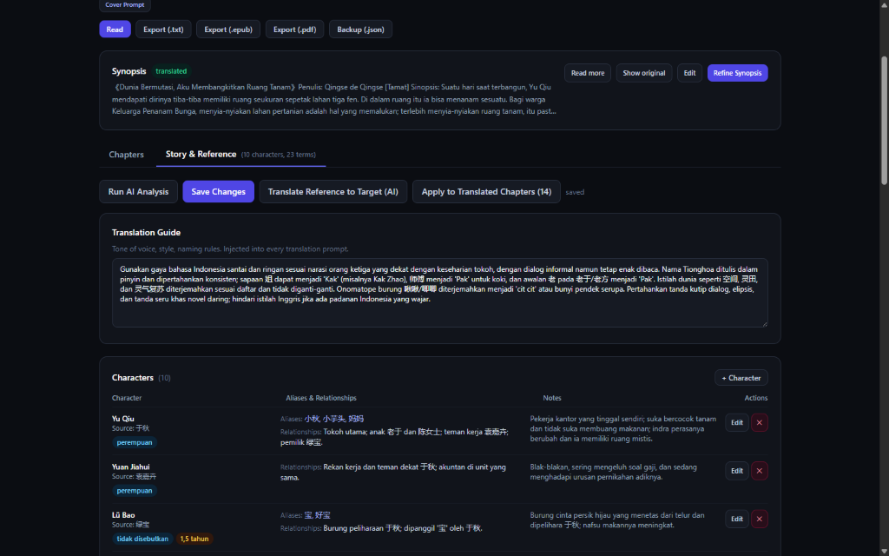
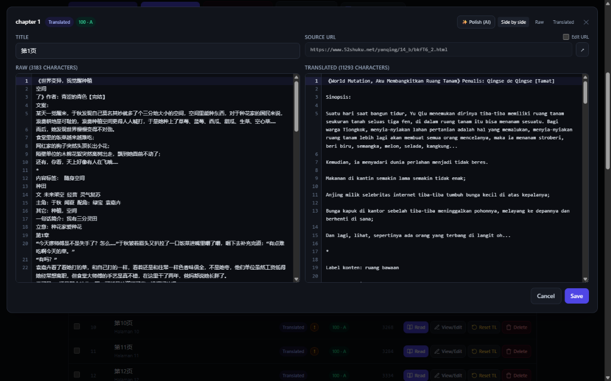
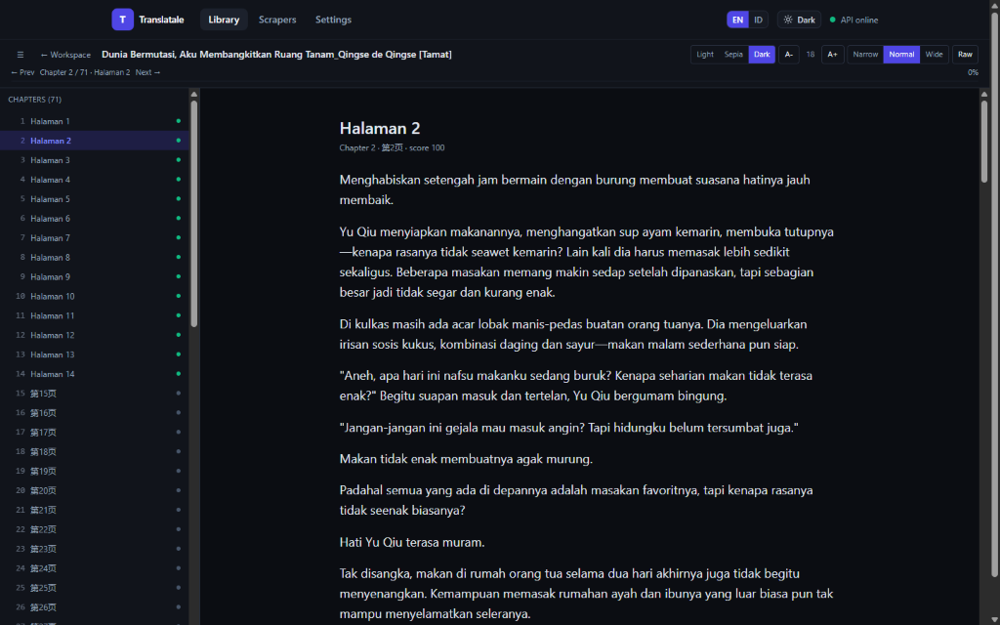
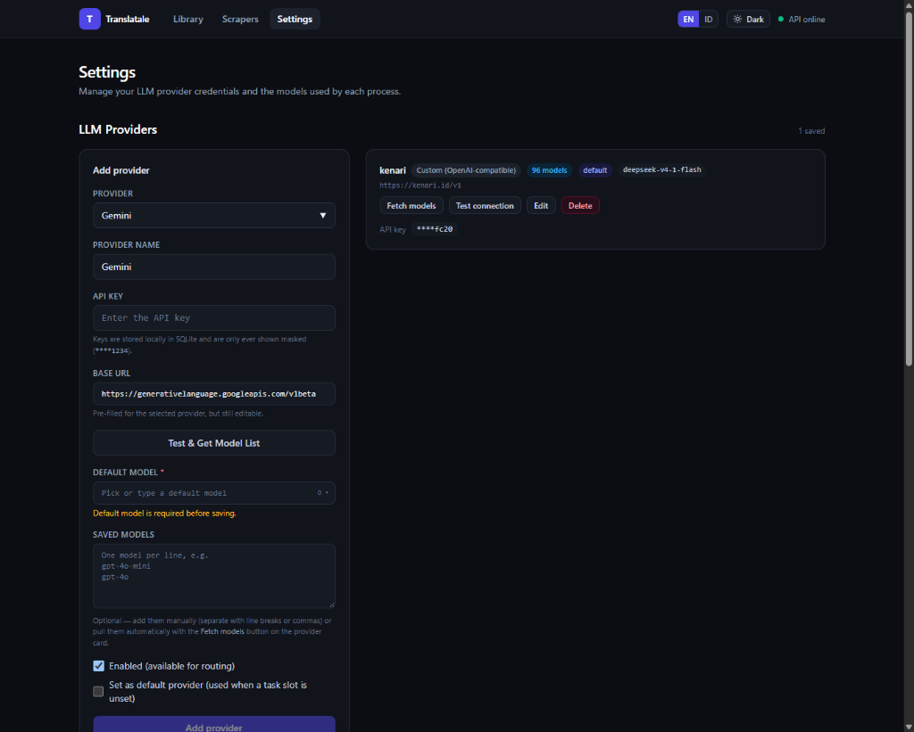

<div align="center">

# 📖 Translatale

**AI-powered web novel & light novel translator, story-bible manager, and offline reader**

Translatale (*Translate* + *Tale*) helps you scrape, analyze, translate, copyedit, and read Chinese, Japanese, and Korean web novels with consistent character names, locations, and terminology — powered by **Gemini, OpenAI, DeepSeek, OpenRouter, Anthropic, Ollama, or any OpenAI-compatible API**.

[](https://github.com/andrian531/translatale/stargazers)
[](https://github.com/andrian531/translatale/issues)
[](LICENSE)
[](https://github.com/andrian531/translatale/releases)

[](https://www.python.org)
[](https://fastapi.tiangolo.com)
[](https://vuejs.org)
[](https://tailwindcss.com)
[](https://sqlite.org)

[Getting Started](#-getting-started) · [Screenshots](#-screenshots) · [Features](#-features) · [Architecture](#-architecture) · [Bahasa Indonesia](README.id.md)

</div>

> **Background:** Translatale is an evolution and full rewrite of [andrian531/novel-translator](https://github.com/andrian531/novel-translator), carrying forward its context-aware, chunked, and reference-driven workflow onto a modern **FastAPI + SQLite + Vue 3** stack with modular per-site scrapers, Markdown AI skills, and a bilingual (`EN` / `ID`) Dark & Light UI.

---

## 📸 Screenshots

### Workspace & Chapter Management
*Novel metadata, 2:3 cover thumbnail, multi-format export, translated synopsis, two-row action bar, cleanliness warnings, and quality badges.*



<details>
<summary>🖼️ View more screenshots (Library, Reference Sheet, Editor &amp; Polish, Web Reader, Settings)</summary>

#### Library


#### Story Analysis & Living Reference Sheet


#### View/Edit Chapter Modal (CodeMirror 6 Line Numbers + AI Polish)


#### Integrated Web Reader


#### Multi-Provider LLM Settings & Routing


</details>

---

## ✨ Features

### 🧠 Story Analysis & Living Reference Sheet

| Feature | Description |
| --- | --- |
| **AI Story & Entity Extraction** | Extracts **Characters** (source name, romanization, age, gender, aliases, relationships, notes), **Locations**, **Terms / Glossary**, and a **Translation Guide** written directly in the novel's target language |
| **Per-Row Latin Format Toggle** | Toggle **Latin** on any term or location to enforce `Romanized (Translation)` format (e.g. `kōngjiān (ruang)`) across translations |
| **One-Click Reference Localization** | Convert older English entries in an existing Reference Sheet into the target language (`Translate Reference to Target (AI)`) without dropping entries |
| **5-Way Parallel Apply Reference** | Updates already-translated chapters concurrently (5 chapters at once), comparing `[SOURCE TEXT]` against `[EXISTING TRANSLATION]` and `[REFERENCE SHEET]` to resolve overlapping terms |
| **Rolling Chapter Context** | Summarizes translated chapters into `STORY SO FAR` (capped to the last 5 chapters) so later chapters preserve continuity without bloating prompts |

### ✍️ Context-Aware Translation & Copyeditor Skills

| Feature | Description |
| --- | --- |
| **Chunked Translation with Retries** | Splits long chapters on paragraph/sentence boundaries, injects the Reference Sheet + rolling context + previous chunk tail, retries failed chunks, and halts batches on chapter failure |
| **Markdown AI Skills (`backend/skills/`)** | Editable Markdown skill prompts for translation, language-specific copyediting (`editor_id.md`, `editor_en.md`), polishing, synopsis refinement, and story analysis — tuned against robotic AI phrasing |
| **Translate Next (5) & Context Guard** | One-click continuation of the next 5 untranslated chapters, plus warnings before translating later chapters out of order |
| **Real-Time Bilingual Job Logger** | Live SSE progress bar & logs synchronized automatically to your active UI language (`EN` / `ID`), with automatic reconnect on reload |
| **Cleanliness Check & Dirty-Line Removal** | Flags chapters containing leftover scrape promos, page navigation (`目录`, `Next Page`), HTML noise, short bodies, or CJK leftovers with a clickable `!` badge and one-click removal inside the modal |
| **CodeMirror 6 Editor & GitHub-Style AI Polish** | Line-numbered, word-wrapped side-by-side `Raw` / `Translated` editor with highlighted flagged lines and an in-modal **`✨ Polish (AI)`** preview showing a 2-column Before/After diff before saving |

### 🌐 Modular Scrapers & Chapter Ingestion

| Feature | Description |
| --- | --- |
| **Per-Site Modular Scrapers** | Site adapters in `backend/scrapers/sites/` with URL preview, TOC sync (*Check for New Chapters*), clickable source links, and a **Scraper AI Analyzer** for scaffolding new sites |
| **Batch Fetch & Circuit Breaker** | Background chapter fetching with configurable rate-limit delay, batch size, and automatic stop after consecutive site errors |
| **Manual & Batch `.txt` Input** | Add chapters manually, paste URLs, or upload multiple `.txt` files directly into any novel workspace |

### 📚 Web Reader, Covers & E-Book Export

| Feature | Description |
| --- | --- |
| **Integrated Web Reader** | Distraction-free reading view with **Dark / Sepia / Light** themes, font size & width controls, chapter sidebar, and automatic last-read progress tracking |
| **Multi-Format Export** | Export translated chapters to **`.epub`** (valid e-book with cover & TOC), **`.pdf`** (full-page cover + per-chapter page breaks), **`.txt`**, and full **`.json`** backup |
| **Cover Thumbnail & AI Prompt Generator** | Upload a 2:3 cover thumbnail shown across Library, Workspace, EPUB, and PDF exports, or generate detailed cover image prompts in **Text + Negative** and **JSON** formats |

### ⚙️ Multi-Provider LLM Routing & Bilingual UI

| Feature | Description |
| --- | --- |
| **7+ Provider Backends** | Supports **Gemini, OpenAI, DeepSeek, OpenRouter, Anthropic, Ollama**, and **Custom OpenAI-compatible** endpoints with credential testing and model discovery (**Test & Get Model List**) |
| **Per-Task Routing & Fallback** | Configure separate primary + fallback models for `translate`, `scrape_analysis`, `story_analysis`, and `cover_prompt`, backed by a global **Default Provider & Model** |
| **Bilingual EN / ID & Dark / Light UI** | Instant language switching (`EN` / `ID`) across UI, error messages, and SSE logs, paired with Dark and Light themes and keyboard-accessible focus indicators |

---

<details>
<summary>🗺️ Architecture &amp; Feature Map</summary>

| Layer | Key Modules | Purpose |
| --- | --- | --- |
| **API & Jobs** | `backend/main.py`, `backend/routers/*.py`, `backend/core/job_runner.py` | FastAPI endpoints, `X-UI-Lang` middleware, background tasks, and SSE log streaming |
| **AI & Skills** | `backend/core/skills.py`, `backend/skills/*.md`, `backend/core/translator.py`, `backend/core/analyzer.py` | Markdown prompt loader, chunked translator, copyeditor polish, and JSON story analysis |
| **Quality & Export** | `backend/core/quality.py`, `backend/core/exporter.py`, `backend/core/synopsis.py` | Cleanliness inspection, translation scoring, and EPUB/PDF/TXT/JSON builders |
| **Scrapers & Storage** | `backend/scrapers/`, `backend/database.py` | Per-site scraper registry and local SQLite persistence (`backend/data/translatale.db`) |
| **Frontend Views** | `frontend/src/views/{Library,Workspace,Reader,Scrapers,Settings}View.vue` | Vue 3 SPA with Vite, Tailwind CSS, CodeMirror 6 (`LineNumberEditor`), and split diff preview |

</details>

---

## 🚀 Getting Started

### Quick Start (Windows)

Double-click `start.bat` (or run `.\start.bat` in a terminal). It automatically:
1. Creates `backend\.venv` and installs `backend\requirements.txt`.
2. Installs `frontend\node_modules` via `npm`.
3. Launches backend (`:8000`) and frontend (`:5173`) in one console window (`[BE]` / `[FE]` prefixes) and opens `http://localhost:5173`.

Press `Ctrl+C` or run `stop.bat` to stop both servers.

### Manual Setup

**Backend** (Python 3.10+):

```bash
cd backend
python -m venv .venv
.venv\Scripts\activate          # Linux/macOS: source .venv/bin/activate
pip install -r requirements.txt
uvicorn main:app --reload --port 8000
```

API docs: `http://127.0.0.1:8000/docs` · Health check: `http://127.0.0.1:8000/api/health`

**Frontend** (Node.js 18+):

```bash
cd frontend
npm install
npm run dev                     # http://localhost:5173 (proxies /api -> :8000)
```

### Tests & Build Verification

```bash
# Backend unit & API tests
cd backend
.venv\Scripts\python -m pytest -v

# Frontend production build
cd frontend
npm run build
```

The SQLite database is created automatically at `backend/data/translatale.db` (override via `TRANSLATALE_DB_PATH` or `TRANSLATALE_DATA_DIR`).

---

## 📄 License

Distributed under the **MIT License**. See [`LICENSE`](LICENSE) for details.
